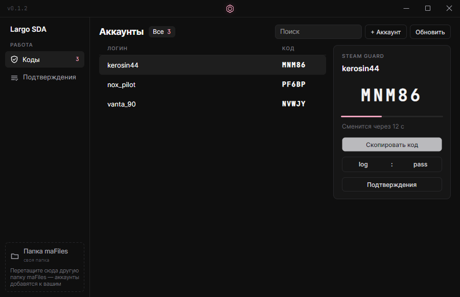

# Largo SDA

Open-source Steam Desktop Authenticator для Windows: коды Steam Guard, подтверждения обменов и маркета.



## Скачать

[LargoSDA.exe](https://github.com/largodevelop/largo-sda/releases/latest) — один файл, без установки, .NET не нужен.

## Возможности

- Коды Steam Guard для всех аккаунтов, время сверяется со Steam
- Подтверждения обменов и маркета
- Добавление аккаунта: привязка нового мобильного Guard по логину и паролю или готовый `.maFile`
- Объединение папок: перетащите другую папку `maFiles` на окно — аккаунты добавятся
- Копирование логина, пароля и `логин:пароль` (пароли шифруются Windows)
- Совместим с `.maFile` от SDA (без шифрования)

Аккаунты хранятся в папке `maFiles` рядом с `LargoSDA.exe`.
Делайте её резервную копию и никому не передавайте.

## Сборка

```bash
dotnet publish src/LargoSda.App -c Release -r win-x64 -o publish
```

## Лицензия

MIT. Шрифт JetBrains Mono — SIL OFL 1.1.
